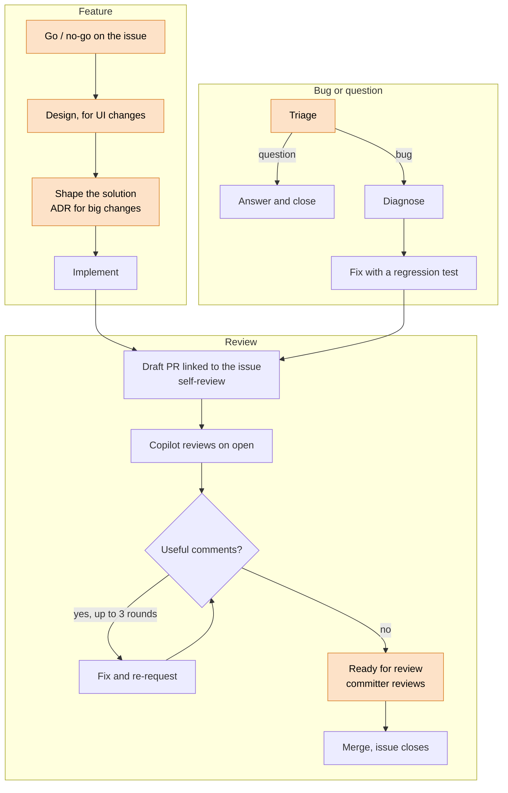

# Contributing to the Data Product Portal

First off, thank you for considering contributing to the Data Product Portal! It's people like you that make this such a great community. We welcome any and all contributions and are excited to see what you'll bring to the project.

To ensure a welcoming and friendly environment, we have a **[Code of Conduct](CODE_OF_CONDUCT.md)** that all contributors, committers, and users must adhere to. Please take a moment to read it before you get started.

For a great introduction to the project, the best place to start is our **[README](README.md)** file.

## How Can I Contribute?

There are many ways to contribute, from writing code and improving documentation to submitting bug reports and feature requests.

* **🐛 Reporting Bugs:** If you find a bug, please first search our [open issues](https://github.com/conveyordata/data-product-portal/issues) to see if it has already been reported. If not, create a new issue with a clear title and a detailed description of the problem.
* **✨ Suggesting Enhancements:** If you have an idea for a new feature or an improvement to an existing one, please open an issue to start a discussion. This allows us to align on the proposal before you invest your time in development.
* **📝 Documentation:** We always need help improving our documentation. If you find something unclear or missing, feel free to open an issue or submit a pull request with your suggested changes.
* **💻 Code Contributions:** You can help by writing code to fix bugs or implement new features. Please follow the development process outlined below.

***

## Our Development Process

As we grow, we are adopting a development process inspired by The Apache Software Foundation to ensure transparency and collaboration. The core idea is to **discuss before you code**.

1.  **Find or Create an Issue:** All work, small fixes included, should be tracked in a GitHub issue. Browse our [existing issues](https://github.com/conveyordata/data-product-portal/issues) to find something to work on. If you want to work on something new, please create a new issue first.
2.  **Claim an Issue:** Comment on the issue to let others know you are working on it.
3.  **Discuss Your Approach:** For any non-trivial change, it is important to discuss your proposed solution in the issue. This helps ensure that your contribution will be accepted and aligned with the project's direction.

### The flow

Features and bugs start differently and end in the same review. Orange steps need a human.

### Labels

Every issue gets a category, `bug` or `enhancement`. Incoming issues also move through these labels:

| Label | Meaning | Set |
|-------|---------|-----|
| `needs-triage` | New, nobody has looked at it yet. | Automatically by the issue templates. Removed at triage. |
| `needs-info` | We asked the reporter a question and wait for the answer. | At triage. |
| `ready-for-agent` | Go. Clear enough that an agent can build it without more questions. | At triage. |
| `ready-for-human` | Go. Needs a person: an open design question, a sensitive area like auth or migrations, or a judgement call. | At triage. |
| `wontfix` | No-go. Closed with a one-line reason. | At triage. |

For UI changes, the design is linked in the issue and signed off before it gets a `ready-for-*` label. If you open an issue for work you start right away, add only the category: deciding to do it is the go. The label history tells us how long issues wait for triage, without anyone tracking it by hand.

### Working with agents

Using an AI agent is optional. If you do, these skills fit the steps above:

| Step | Skills |
|------|--------|
| Triage | `triage` |
| Shape the solution | `grill-with-docs` (or `grill-me`), `wayfinder` for big unclear work, `adr`, `prototype` to test technical assumptions |
| Break it down | `to-spec`, `to-tickets` |
| Diagnose a bug | `diagnosing-bugs` |
| Implement | `implement` |
| Self-review | `code-review` |
| Human review | `pr-description`, `teach` |
| Improve the process | `retro`, across many sessions and PRs |

Most come from [mattpocock/skills](https://github.com/mattpocock/skills); `adr` and `pr-description` live in `.claude/skills/`. Claude Code (`.claude/settings.json`) and Copilot CLI (`.github/copilot/settings.json`) enable the plugin for this repo and keep it updated. In VS Code or other agents, follow the [installation steps](https://github.com/mattpocock/skills#installation-30-second-setup). The repo-specific configuration these skills read is in `docs/agents/`.

***

## Proposing Major Architectural Changes

Before starting work on a **large feature or significant architectural change**, it is mandatory to first present a design proposal. This prevents wasted effort and ensures that the core team is aligned with your vision.

The process is as follows:

1.  **Create an Issue:** Open a GitHub issue with a title that clearly describes the proposed change (e.g., "Architecture Proposal: [Your Feature]").
2.  **Describe the Architecture:** In the issue description, provide a detailed write-up of your proposed architecture. This should include:
    * The **motivation** and problem you are solving.
    * A high-level **design overview**.
    * Details on how it affects different parts of the application.
    * Any potential **risks or drawbacks**.
3.  **Review by Committers:** Tag the project's committers in the issue. **The project committers are committed to reviewing these proposals in a timely manner.** Implementation should only begin after the proposed architecture has been discussed and has received approval from at least one project committer.

***

## Pull Request Process

We follow a "Review Then Commit" workflow. All contributions are made via Pull Requests (PRs).

1.  **Fork the Repository:** Create a fork of the `data-product-portal` repository to your own GitHub account.
2.  **Create a Branch:** Create a new branch from `main` for your changes. Please use a descriptive branch name (e.g., `feature/new-auth-module` or `fix/login-bug-123`).
3.  **Develop Locally:** Make your changes, ensuring you follow the project's coding style. Make sure to add or update tests as appropriate.
4.  **Commit Your Changes:** Use clear and descriptive commit messages. Reference the issue number in your commit messages (e.g., `feat: Add OAuth2 support (#123)`).
5.  **Run Tests:** Before submitting a PR, ensure that the full test suite passes locally.
6.  **Submit a Pull Request:** Push your branch to your fork and open a draft pull request against the `main` branch of the original repository.
    * In the PR description, link to the issue you are resolving (e.g., "Closes #123").
    * Provide a clear summary of the changes you have made.
    * Copilot reviews the draft when it opens. Address its comments and re-request a review until it has nothing useful left, up to about 3 rounds. Then mark the PR ready for review.
7.  **Address Feedback:** A project committer will review your PR. They may ask for changes or provide suggestions. Please address the feedback and push your changes to the same branch.
8.  **Merging:** Once the PR is approved by a committer and all automated checks have passed, it will be merged into the `main` branch.

Congratulations! 🎉 Your contribution is now part of the project. We truly appreciate your effort and dedication.

***

## Extending the RBAC System

The RBAC system is designed to be extensible. If you need additional actions or scopes:

1. **Define New Actions**: Add action constants to the `AuthorizationAction` enum in the backend and frontend
2. **Apply Authorization Checks**: Use the `Authorization.enforce()` dependency on relevant API endpoints
3. **Update UI**: Conditionally show/hide UI elements based on user permissions
4. **Test Thoroughly**: Ensure new permissions work correctly across all scopes
