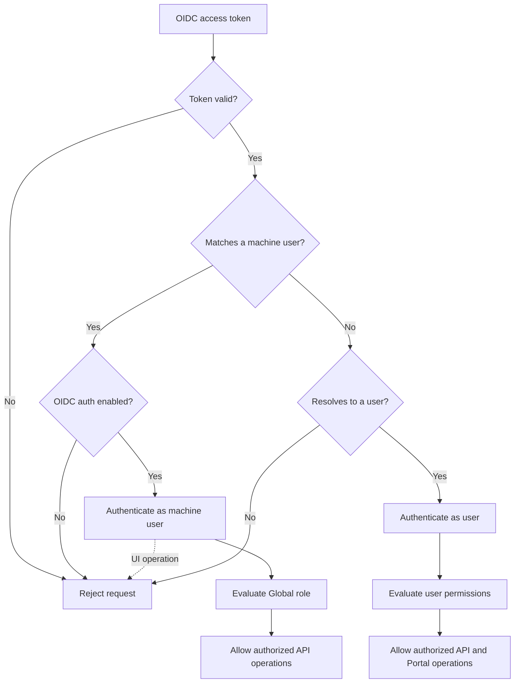
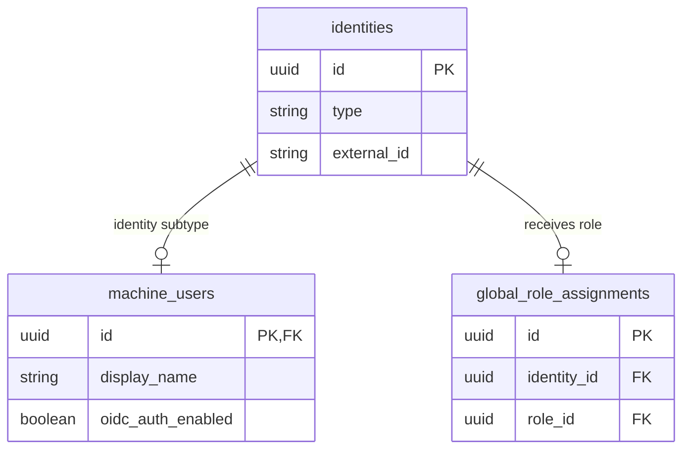

# Allow Pre-provisioned Machine Users to Authenticate Against the API

**Status:** Proposed

## Context and Problem Statement

Portal currently supports users as the only identity type that can authenticate. 
Machine users can receive Global and Data Product roles, but they cannot use those permissions to operate the API.

For example, an external identity provisioner needs to create, retrieve and remove identities through the Portal API. 
Using the shared API key maps the provisioner to the system account and grants broader access than required. 
Representing the provisioner as a user would mix interactive users with non-human API clients.

Portal needs a way to enable OIDC authentication for a pre-provisioned machine user and authorize it through the existing Global role model. 
The machine user must only be able to operate API endpoints and must not be accepted as an UI Portal user.

## Decision Drivers

* Allow a machine user to authenticate without representing it as a user.
* Reuse the existing Global role-assignment model.
* Grant only the specified permissions required by an external provisioner.
* Require explicit pre-provisioning before a machine user can authenticate.
* Restrict who can enable OIDC authentication independently from normal machine-user management.
* Keep interactive Portal operations restricted to users.
* Avoid using the shared administrator API key for this integration.

## Considered Options

* **Option 1: Shared API key** — authenticate the provisioner as the existing system account.
* **Option 2: Machine user with OIDC authentication enabled** — allow a pre-provisioned machine user to authenticate through OIDC and evaluate its Global role when it calls the API.
* **Option 3: Represent the provisioner as a user** — create a Portal user matching the OIDC principal and assign the required Global role.

## Decision Outcome

**Chosen option:** *Option 2: Machine user with OIDC authentication enabled*.

A machine user can optionally be enabled for OIDC authentication. 
When Portal receives a valid token, it uses the token subject to resolve either a user or a pre-provisioned machine user by its `external_id`.

The machine user receives a Global role containing the required identity-management permissions. 
It can use these permissions through the API, while operations that require an interactive user continue to reject machine users.

Machine users without OIDC authentication enabled remain non-authenticating identities.



### Confirmation

* A machine user can optionally be enabled for OIDC authentication.
* Unknown OIDC machine principals are not created automatically.
* Authenticated machine users are evaluated through their existing Global role assignments.
* UI operations remain restricted to users.
* The existing API key continues to work.

## Pros and Cons of the Options

### Option 1: Shared API key

* **Good, because** it already supports non-interactive API access.
* **Bad, because** every client is represented by the same system account.
* **Bad, because** the system account has broader permissions than the provisioner requires.

### Option 2: Machine user with OIDC authentication enabled

* **Good, because** the provisioner is represented by the correct Portal identity type.
* **Good, because** existing Global roles can provide least-privilege access.
* **Good, because** authentication must be explicitly enabled for each machine user.
* **Good, because** enabling authentication is authorized independently from managing machine users.
* **Good, because** API and interactive access remain separated.
* **Bad, because** authentication and authorization can no longer assume every authenticated principal is a user.

### Option 3: Represent the provisioner as a user

* **Good, because** it follows the current authentication flow.
* **Bad, because** a non-human principal is represented as an interactive user.
* **Bad, because** user-specific Portal operations would need additional restrictions.
* **Bad, because** it weakens the distinction between users and machine users established by the identity model.

## Design Details

### Authentication model

The `machine_users` table receives an `oidc_auth_enabled` column that defaults to `false`.



The machine user's `external_id` corresponds to the subject of the validated OIDC token:

```text
external_id ← sub
```

The `oidc_auth_enabled` field allows authentication to be enabled or suspended without deleting the machine user or its role assignments. 
Its default value of `false` ensures that existing and newly created machine users cannot authenticate unless this is explicitly enabled.

### Machine-user authentication API

The existing machine-user create and update operations do not allow changing `oidc_auth_enabled`. 
New machine users therefore keep the default value of `false`, including when created by another machine user.

OIDC authentication is enabled or disabled through a dedicated operation:

```text
PUT /api/v2/machine-users/{id}/oidc-authentication
```

The operation accepts the intended authentication state:

```json
{
  "enabled": true
}
```

This operation requires a new `GLOBAL__MANAGE_MACHINE_USER_OIDC_AUTH` permission. 

### API and interactive operations

API Endpoints accept an authenticated user or machine user. 
Operations representing the current interactive user continue to require a user. This includes:

```text
/api/v2/users/current
/api/v2/users/current/groups
/api/v2/users/current/pending_actions
/api/v2/users/current/my_requests
```

A machine-user token calling one of these operations is rejected. 
Since the frontend resolves the current user before loading Portal, 
a machine user cannot establish an interactive Portal session.

### Pre-provisioning flow

The example external provisioner is configured through the existing Portal administration model:

1. Create the machine user.
2. Enable OIDC authentication through the dedicated operation.
3. Create an approved Global role assignment targeting the machine-user identity.
