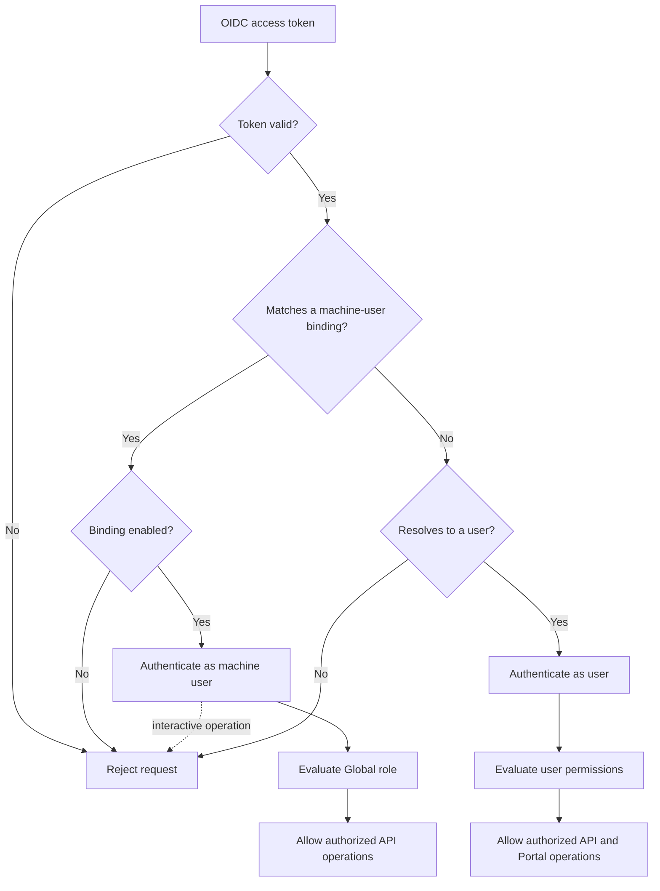
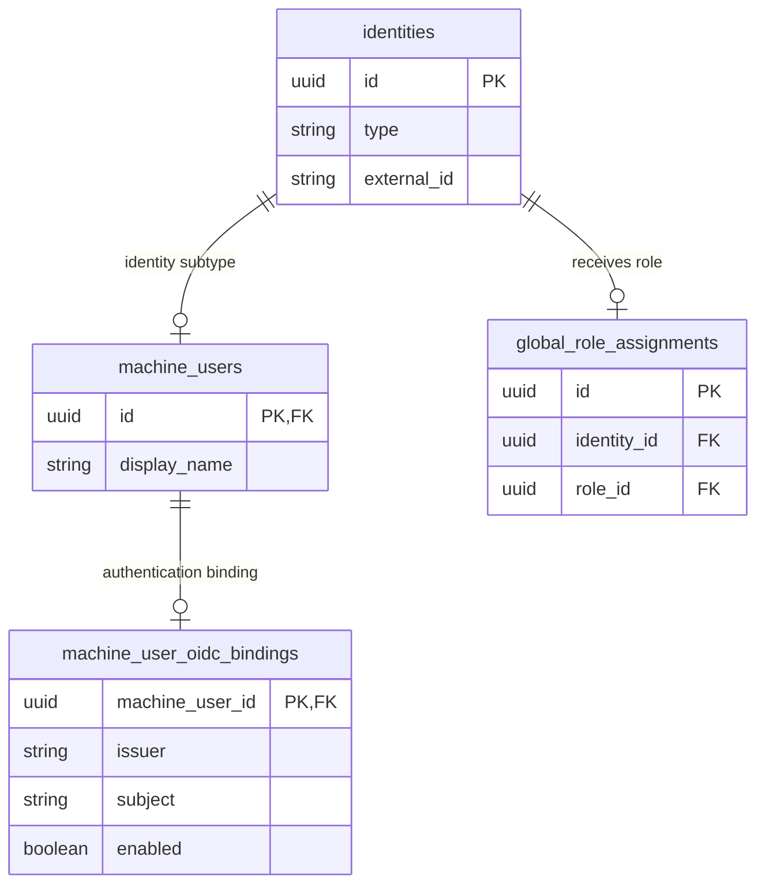

# Allow Pre-provisioned Machine Users to Authenticate Against the API

**Status:** Proposed

## Context and Problem Statement

Portal currently supports users as the only identity type that can authenticate. Machine users can receive Global and Data Product roles, but they cannot use those permissions to operate the API.

An external identity provisioner needs to create, retrieve and remove identities through the Portal API. Using the shared API key maps the provisioner to the system account and grants broader access than required. Representing the provisioner as a user would mix interactive users with non-human API clients.

Portal needs a way to pre-provision a machine user, connect it to an OIDC principal and authorize it through the existing Global role model. The machine user must only be able to operate API endpoints and must not be accepted as an interactive Portal user.

## Decision Drivers

* Allow an identity provisioner to authenticate without representing it as a user.
* Reuse machine users and the existing Global role-assignment model.
* Grant only the identity-management permissions required by the provisioner.
* Require explicit pre-provisioning before a machine user can authenticate.
* Keep interactive Portal operations restricted to users.
* Avoid using the shared administrator API key for this integration.

## Considered Options

* **Option 1: Shared API key** — authenticate the provisioner as the existing system account.
* **Option 2: Machine user with an OIDC authentication binding** — bind a pre-provisioned machine user to an OIDC principal and evaluate its Global role when it calls the API.
* **Option 3: Represent the provisioner as a user** — create a Portal user matching the OIDC principal and assign the required Global role.

## Decision Outcome

**Chosen option:** *Option 2: Machine user with an OIDC authentication binding*.

A machine user can optionally be connected to an OIDC principal. When Portal receives a valid token, it resolves the token to either a user or a pre-provisioned machine user.

The machine user receives a Global role containing the required identity-management permissions. It can use these permissions through the API, while operations that require an interactive user continue to reject machine users.

Machine users without an OIDC binding remain non-authenticating identities.



### Confirmation

* A machine user can optionally be bound to an OIDC principal.
* Unknown OIDC machine principals are not created automatically.
* Authenticated machine users are evaluated through their existing Global role assignments.
* The provisioner receives only the required identity-management permissions.
* Interactive and current-user operations remain restricted to users.
* The existing API key continues to work but is not required by the identity provisioner.

## Pros and Cons of the Options

### Option 1: Shared API key

* **Good, because** it already supports non-interactive API access.
* **Bad, because** every client is represented by the same system account.
* **Bad, because** the system account has broader permissions than the provisioner requires.

### Option 2: Machine user with an OIDC authentication binding

* **Good, because** the provisioner is represented by the correct Portal identity type.
* **Good, because** existing Global roles can provide least-privilege access.
* **Good, because** authentication must be explicitly enabled for each machine user.
* **Good, because** API and interactive access remain separated.
* **Bad, because** authentication and authorization can no longer assume every authenticated principal is a user.

### Option 3: Represent the provisioner as a user

* **Good, because** it follows the current authentication flow.
* **Bad, because** a non-human principal is represented as an interactive user.
* **Bad, because** user-specific Portal operations would need additional restrictions.
* **Bad, because** it weakens the distinction between users and machine users established by the identity model.

## Design Details

### Authentication binding model

Machine users remain stored as identities using the model introduced in ADR-0023. A new `machine_user_oidc_bindings` table connects selected machine users to an OIDC principal.



`machine_user_id` is both the primary key and a foreign key, allowing at most one OIDC binding per machine user.

The `(issuer, subject)` combination is unique. This prevents the same external principal from authenticating as multiple machine users.

The fields correspond to the validated OIDC claims:

```text
issuer  ← iss
subject ← sub
```

The `enabled` field allows authentication to be suspended without deleting the binding, machine user or its role assignments.

Deleting the machine user also deletes its authentication binding.

### Machine-user authentication-binding API

Portal adds operations for managing the binding separately from the machine user:

```text
GET    /api/v2/machine-users/{id}/oidc-binding
PUT    /api/v2/machine-users/{id}/oidc-binding
DELETE /api/v2/machine-users/{id}/oidc-binding
```

Creating or replacing a binding uses the following representation:

```json
{
  "issuer": "https://identity-provider.example.com/tenant",
  "subject": "identity-provisioner",
  "enabled": true
}
```

These operations require the existing permission for updating machine users. The issuer must be trusted by the Portal OIDC configuration; adding a binding does not allow introducing a new token issuer.

The binding is managed separately so creating a machine user does not automatically allow it to authenticate.

### API and interactive operations

Endpoints that support automated identity management accept an authenticated user or machine user. This includes the existing API operations for users, groups, memberships and machine users.

Operations representing the current interactive user continue to require a user. This includes:

```text
/api/v2/users/current
/api/v2/users/current/groups
/api/v2/users/current/pending_actions
/api/v2/users/current/my_requests
```

A machine-user token calling one of these operations is rejected. Since the frontend resolves the current user before loading Portal, a machine user cannot establish an interactive Portal session.

### Pre-provisioning flow

The identity provisioner is configured through the existing Portal administration model:

1. Create the machine user.
2. Add its OIDC binding.
3. Create an approved Global role assignment targeting the machine-user identity.
4. Give the role the required identity-management permissions.
