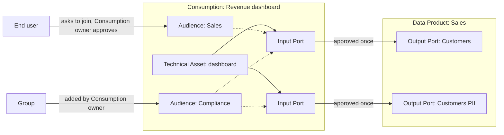

# Consumption of Data by Dashboards, Applications and End Users

**Status:** Proposed

## Context and Problem Statement

Portal models two things that hold an Input Port on an Output Port: a Data Product and an Exploration ([ADR-0016](./0016-light-weight-data-products.md)).
Both are kinds of the same base model, and the Input Port references that base model ([ADR-0021](./0021-input-ports-and-input-port-requests.md)).
A person never holds an Input Port; a person only requests one on behalf of a Data Product or an Exploration.

Many consumers produce nothing: a Power BI dashboard for a team, an organisation-wide report, an application or an AI agent, a notebook.
Today such a consumer must be modelled as a Data Product, which brings Output Ports, data contracts and a team it does not need, or as an Exploration, which has a single user as owner, cannot be shared and is not representable by the name.
The people who read a dashboard (end users) have no place in Portal at all.
They cannot discover a dashboard, ask to see it, or be granted the data it shows.

How a dashboard reads its data decides who needs access:

* **Owner identity**: the dashboard reads with one identity, its owner's or a service principal's. Only that identity needs a grant on the Output Port.
* **Viewer identity**: the dashboard reads with the identity of each person viewing it (e.g. Power BI single sign-on to Databricks). Every end user needs a grant on the Output Port.

The question is how Portal models a consumer that only consumes, its end users and their access, without forcing it into a Data Product or an Exploration.

### Terms used in this ADR

* **Consumption**: working name for a consumer that only consumes, such as a dashboard, an application, an agent or a notebook. See the open question on its name.
* **End user**: one person who reads a Consumption without being on a team that owns data.
* **Audience**: a set of identities (persons and Groups, see [ADR-0023](./0023-external-identities-group-based-auth.md)) that may see a Consumption, linked to one or more of its Input Ports. It can hold several Groups and individual end users, so it is not necessarily one Group from the identity provider. A Consumption can have several audiences, for example one that sees personal data and one that doesn't.

### The requester rule

The rule "only a Data Product or Exploration requests an Output Port, never a person" is not written down anywhere.
It protects three things, and this ADR states it in that form of three principles:
1. Purposeful: every Input Port has a holder with a stated purpose
2. Ownership: someone who answers for it
3. Identity: identity the Provisioner can grant to.
"Never a person" as a direct consumer from the dataproduct is based on those three principles.
Explorations already show that a person may consume when wrapped in a container with a purpose and a lifecycle.
Other tools and competitors let persons request access directly (Purview, Collibra, Unity Catalog, Witboost); Portal keeps the rule and scores the options against it.

### Scenarios

Every option is scored against these scenarios.
Scenarios where it matters are scored for both owner and viewer identity.

| Scenario | Description |
|---|---|
| Team dashboard | About 5 readers who know each other. |
| Organisation-wide dashboard | About 500 readers who don't know each other and come and go. |
| Application or agent | An application or agent that reads with a service principal. |
| Personal connection | A single person with a permanent connection. |
| Exploration | A time-boxed exploration that may grow into a dashboard later on. |
| Dashboard on own data | The team that owns a Data Product builds a dashboard on its own Output Port. |

## Decision Drivers

1. Both owner identity and viewer identity are supported.
2. Every Input Port has a holder with a purpose, someone who answers for it and an identity the Provisioner can grant to. In other words the three principles above hold.
3. End users discover a dashboard and request access without joining a team.
4. The Output Port owner sees who reads and why, with lineage to the dashboard, and can revoke access.
5. It scales to large audiences that change often (organisation-wide dashboard).
6. The new concept is light.
7. It fits Groups in their three roles: audience, requester and approver.
8. Every consumer that works with data can be listed in Portal, so the organisation sees who uses which Output Port. How much Portal governs beyond listing (approvals, audience) is the organisation's choice.
9. A team that already owns the data adds a dashboard without extra ceremony; requests and approvals appear only when an ownership boundary is crossed.

## Out of scope

* Mapping Power BI objects (workspace, semantic model, report, app) onto Portal concepts. This belongs to a later ADR on tools and assets.
* Deciding whether an Output Port is single-technology. That gets its own ADR; this ADR records how the options depend on it (see "Relation to single-technology Output Ports").
* How an Exploration is promoted to a Consumption or a Data Product. The owner promotes it; the mechanics are a separate effort.
* Column masks and row filters inside the data platform. The data platform enforces them on group membership; Portal only manages who is in which audience. Splitting what each viewer sees only works with viewer identity, or with owner identity plus the BI tool's own row-level security.

## Considered Options

### Where the consumer lives

* **Option 1: Dashboard in its own Data Product**: the dashboard team creates a Data Product that holds the Input Ports and has no Output Ports.
* **Option 2: Dashboard inside an existing Data Product**: the dashboard sits next to the Output Ports of a Data Product the team already owns, as an asset that is not an Output Port.
* **Option 3: Dashboard as an Exploration**: the dashboard is an Exploration. A variant gives every user a default personal Exploration for a personal connection.
* **Option 4: Group as requester**: a Group holds the Input Port, and its members get access.
* **Option 5: Persons request the Output Port directly**: an end user holds the Input Port. Variants bundle several Output Ports in one request, define a request policy per requester type, or assign access automatically by attribute ("everyone in Finance").
* **Option 6: Recorded exposure, no access management**: Portal records that a dashboard reads an Output Port, for lineage only. Access is handled elsewhere.
* **Option 7: Consumption as a new concept**: a Consumption is owned by a user or Group, holds Input Ports, and has an audience of end users and Groups.

### How a Consumption shares its own dashboard

This axis applies to the options that have a container to share from (Options 1, 2, 3 and 7).
Readers going straight to the upstream Output Port is Option 5.

* **Option A: Output Port on the Consumption**: the dashboard is published as an Output Port.
* **Option B: Audiences**: the Consumption owner defines one or more audiences, links each to some of the Consumption's Input Ports, and approves the end users and Groups that join.
* **Option C: The BI tool manages readers**: readers are managed in the BI tool, and Portal records the audience.

## Decision Outcome

**Chosen option:** *Option 7: Consumption as a new concept*, sharing through *Option B: Audiences*, with *Option 2: Dashboard inside an existing Data Product* for dashboards that stay within the owning team.
This is the proposed direction for the planning session, not a locked decision.

Option 7 is the only option that holds in every scenario, and it keeps the requester rule: the Consumption is the holder with a purpose, its owner answers for it, and it has an identity to grant to.
A Consumption only consumes.
It never becomes a Data Product, because it never publishes data for others to build on.
A semantic model that other teams reuse is producing, and belongs in a Data Product.

* A team without a Data Product (team or organisation-wide dashboard) creates a Consumption, for example "Revenue dashboard", states its purpose and requests the Sales Output Port. The Sales owner approves once. End users ask to join its audience, and the Consumption owner approves.
* A dashboard that only the team owning the data reads, such as a quality dashboard, is a Technical Asset of a type that cannot be shared, inside its Data Product. It reads with the Data Product's identity, needs no request and no audience, and is listed as an asset of the Data Product. This works today. It becomes a Consumption once end users outside the team need to see it.
* An application or agent is a Consumption whose identity is a service principal.
* A single person exploring or with a personal connection keeps using an Exploration, unchanged.
* A dashboard that is only listed is a Consumption without an audience that reads with its owner's identity. Portal has the lineage, and the organisation decides whether it governs more.

A Consumption's owner is a user or a Group, like a Data Product's, never a Data Product: an owner is an identity, and a Data Product is not one.
A Consumption has a kind (dashboard, application, agent, notebook); the technology lives on its Technical Asset, which is of a type that cannot be shared.

With viewer identity, joining an audience grants upstream access automatically.
The Output Port owner approves the Consumption's Input Port once, following the Output Port's Access Function as today, knowing the Consumption uses viewer identity.
From then on the Consumption owner manages the audiences: which audiences exist, who is in them, and which Input Ports each one is linked to.
The grants of an audience's Input Ports follow its members.
There is no cap on an audience and no approval per end user or Group by the Output Port owner.
The Data Product sees the Consumption as consumer, and through lineage which audience is linked to which of its Output Ports.
Its control is revoking the Input Port.

Sensitive data is split with Output Ports, not inside the Consumption.
For example, the Sales Data Product publishes "Customers" and "Customers PII", and the Revenue dashboard holds an Input Port on each.
Audience "Sales" is linked to the "Customers" Input Port, and audience "Compliance" to both.
Everyone opens the same dashboard, and only Compliance sees the personal data.

A person never holds an Input Port.
End users get data access only as members of an audience whose Consumption holds the Input Port.

### Same owner

When the requester already holds approve rights on the Output Port, the request is approved automatically and recorded.
This is the permission the existing "grant directly" endpoint checks.
It applies to Data Products too: today a Data Product requesting its own team's Output Port goes to pending and the team approves itself.
Same ownership removes approval only; with viewer identity the end users still need to join an audience.

### Confirmation

* A Consumption is a new concept, owned by a user or Group, that holds Input Ports and has an audience.
* Persons never hold an Input Port; end users reach data only through an audience.
* A Consumption has one or more audiences, each linked to one or more of its Input Ports, managed by the Consumption owner.
* With viewer identity, audience members receive the upstream grants of the Input Ports their audience is linked to.
* Lineage shows the Data Product which audience is linked to which of its Output Ports.
* Requests from someone who holds approve rights on the Output Port are approved automatically, for Consumptions and Data Products.
* Explorations are unchanged.
* A dashboard that only the owning team reads stays a not-shareable Technical Asset in its Data Product. This assumes the Provisioner lets a Data Product's team members read the Data Product's own data.

## Pros and Cons of the Options

### Scoring per scenario

🟢 good, 🟡 works with friction, 🔴 fails. Owner and Viewer are the identity the dashboard reads with.

<table>
  <thead>
    <tr>
      <th rowspan="2">Option</th>
      <th colspan="2">Team dashboard</th>
      <th colspan="2">Organisation-wide dashboard</th>
      <th rowspan="2">Application or agent</th>
      <th colspan="2">Personal connection</th>
      <th rowspan="2">Exploration</th>
      <th colspan="2">Dashboard on own data</th>
    </tr>
    <tr>
      <th>Owner</th>
      <th>Viewer</th>
      <th>Owner</th>
      <th>Viewer</th>
      <th>Owner</th>
      <th>Viewer</th>
      <th>Owner</th>
      <th>Viewer</th>
    </tr>
  </thead>
  <tbody>
    <tr>
      <td>1. Own Data Product</td>
      <td align="center">🟡</td>
      <td align="center">🔴</td>
      <td align="center">🟢</td>
      <td align="center">🔴</td>
      <td align="center">🟢</td>
      <td align="center">🔴</td>
      <td align="center">🔴</td>
      <td align="center">🔴</td>
      <td align="center">🔴</td>
      <td align="center">🔴</td>
    </tr>
    <tr>
      <td>2. Inside existing Data Product</td>
      <td align="center">🟡</td>
      <td align="center">🟡</td>
      <td align="center">🟢</td>
      <td align="center">🟡</td>
      <td align="center">🟡</td>
      <td align="center">🔴</td>
      <td align="center">🔴</td>
      <td align="center">🔴</td>
      <td align="center">🟢</td>
      <td align="center">🟡</td>
    </tr>
    <tr>
      <td>3. Exploration</td>
      <td align="center">🟡</td>
      <td align="center">🔴</td>
      <td align="center">🔴</td>
      <td align="center">🔴</td>
      <td align="center">🔴</td>
      <td align="center">🟢</td>
      <td align="center">🟢</td>
      <td align="center">🟢</td>
      <td align="center">🔴</td>
      <td align="center">🔴</td>
    </tr>
    <tr>
      <td>4. Group as requester</td>
      <td align="center">🟡</td>
      <td align="center">🟢</td>
      <td align="center">🟡</td>
      <td align="center">🟢</td>
      <td align="center">🔴</td>
      <td align="center">🔴</td>
      <td align="center">🔴</td>
      <td align="center">🔴</td>
      <td align="center">🟡</td>
      <td align="center">🟡</td>
    </tr>
    <tr>
      <td>5. Persons request directly</td>
      <td align="center">🔴</td>
      <td align="center">🟢</td>
      <td align="center">🔴</td>
      <td align="center">🟡</td>
      <td align="center">🔴</td>
      <td align="center">🟡</td>
      <td align="center">🟢</td>
      <td align="center">🟡</td>
      <td align="center">🟡</td>
      <td align="center">🟡</td>
    </tr>
    <tr>
      <td>6. Recorded exposure</td>
      <td align="center">🟡</td>
      <td align="center">🔴</td>
      <td align="center">🟡</td>
      <td align="center">🔴</td>
      <td align="center">🟡</td>
      <td align="center">🟡</td>
      <td align="center">🔴</td>
      <td align="center">🟡</td>
      <td align="center">🟢</td>
      <td align="center">🔴</td>
    </tr>
    <tr>
      <td>7. Consumption</td>
      <td align="center">🟢</td>
      <td align="center">🟢</td>
      <td align="center">🟢</td>
      <td align="center">🟢</td>
      <td align="center">🟢</td>
      <td align="center">🟡</td>
      <td align="center">🟡</td>
      <td align="center">🟡</td>
      <td align="center">🟡</td>
      <td align="center">🟡</td>
    </tr>
  </tbody>
</table>

### Option 1: Dashboard in its own Data Product

* **Good, because** it needs no change: a Data Product already holds Input Ports.
* **Good, because** it keeps the requester rule.
* **Bad, because** it puts a whole Data Product on a team that produces nothing.
* **Bad, because** with viewer identity end users must become members of the Data Product to get access, so they join a team.
* **Bad, because** the catalog fills with Data Products that publish nothing.

### Option 2: Dashboard inside an existing Data Product

* **Good, because** a team's dashboard on its own data needs no request at all.
* **Good, because** a dashboard as an asset that is not an Output Port has precedent: Technical Asset types that cannot be shared already exist
* **Neutral, because** viewer identity still needs an audience mechanism.
* **Bad, because** a team without a Data Product has to create one, which is the cost of Option 1.
* **Bad, because** one Data Product then faces both other Data Products and end users.

### Option 3: Dashboard as an Exploration

* **Good, because** it fits a personal connection and a time-boxed exploration.
* **Good, because** it needs no new concept.
* **Bad, because** an Exploration has a single user as owner and sits outside role-based authorization, so a Group can't own it ([ADR-0023](./0023-external-identities-group-based-auth.md)).
* **Bad, because** it has no audience shared dashboards.

### Option 4: Group as requester

* **Good, because** a Group has an identity to grant to and scales to large audiences.
* **Bad, because** a Group has no purpose of its own, which breaks the requester rule.
* **Bad, because** nothing records the dashboard, so there is no lineage.
* **Bad, because** it needs a schema change: the Input Port references the Data Product and Exploration base model, and the provisioning event needs a new requester type.

### Option 5: Persons request the Output Port directly

* **Good, because** it is how most other tools work, and end users need no container.
* **Good, because** it fits a single person with viewer identity.
* **Bad, because** a person holds the Input Port, which breaks the requester rule.
* **Bad, because** nothing records the dashboard, so there is no lineage.
* **Bad, because** an organisation-wide dashboard means hundreds of requests, unless access is assigned automatically by attribute.
* **Bad, because** Output Port roles still reference users, not identities, so this needs a model change.

### Option 6: Recorded exposure, no access management

* **Good, because** it is the lightest option: it lists a consumer without governing it.
* **Good, because** it gives the Output Port owner lineage to the dashboard, as dbt exposures do.
* **Neutral, because** it combines with any option that holds the Input Port.
* **Bad, because** it never grants access, so viewer identity is not supported.

### Option 7: Consumption as a new concept

* **Good, because** it holds in every scenario, for owner and viewer identity.
* **Good, because** it keeps the requester rule: purpose, someone who answers for it, and an identity.
* **Good, because** end users discover a Consumption and ask to join it without joining a team.
* **Good, because** the Output Port owner sees the Consumption, its purpose and which audience is linked to which Output Port, and can revoke it.
* **Good, because** a Group fits as owner, as audience and as approver.
* **Good, because** it covers both ends: a Consumption without an audience is only listed, one with an audience is governed.
* **Neutral, because** Collibra's Data Usage and dbt's exposure show the idea exists, but no tool combines it with access management.
* **Bad, because** it is a new concept in the domain, the UI and the provisioning events.
* **Bad, because** there are two ways to model a dashboard, separated by who reads it: inside the Data Product for the owning team, a Consumption beyond it.

### Option A: Output Port on the Consumption

* **Good, because** everything it needs already exists.
* **Bad, because** sharing a dashboard is not producing data, and the Consumption becomes a Data Product in all but name.

### Option B: Audiences

* **Good, because** it supports viewer identity, with grants following membership.
* **Good, because** one dashboard can show personal data to some audiences only, by reusing Output Ports and their Access Functions instead of a new sensitivity mechanism.
* **Good, because** the Consumption owner manages audiences and the Output Port owner keeps an overview through lineage.
* **Bad, because** after approving the Input Port, the Output Port owner fully trusts the Consumption owner with who sees the data; their control is revoking the Input Port.
* **Bad, because** when a Group is in an audience, new members in the identity provider get access without anyone in Portal approving them.
* **Bad, because** it is a new mechanism.

### Option C: The BI tool manages readers

* **Good, because** it is the lightest, and the BI tool already manages its readers.
* **Bad, because** Portal's audience record drifts from the BI tool.
* **Bad, because** revocation leaves Portal.

## Relation to single-technology Output Ports

Today an Output Port links several Technical Assets, and an Input Port request picks one access mode.
A dashboard is never an Output Port, whatever that decision: it is a Technical Asset of a type that cannot be shared.
If Output Ports become single-technology, a Power BI semantic model that other teams reuse becomes a natural Output Port of a Data Product.

| Coupling | Options | Why |
|---|---|---|
| Independent | 1, 3, 4, 6 | They decide who holds the Input Port or what gets recorded, not what an Output Port contains. |
| Weakly coupled | 2, 5, 7 with viewer identity | An audience member needs one specific grant. With a mixed Output Port that is the access mode the Input Port chose, which the request already carries. |
| Coupled | Compatibility check | With single-technology Output Ports Portal can check that a Consumption can reach an Output Port. With mixed ones it can only warn. |

## Open Questions

1. **Name.** "Consumption" is a working name. Candidates:
   * Consumption: neutral, used by no tool or standard.
   * Exposure: dbt's term, but it runs opposite to Data Products exposing data through Output Ports.
   * Data Usage: used in Open Data Mesh's DPDS, Bitol's ODPS and Collibra, and carries the purpose.
   * Use Case: used in the Open Data Product Specification and Purview, and carries the purpose, but it is generic.
   * Data App: concrete for business users, but a notebook is not an app.

   Rejected: Consumer (to avoid per `CONTEXT.md`), Sink (jargon that suggests writing), Terminal, Endpoint and Destination (clash with existing meanings), Subscriber and Recipient (they name a party, not a thing).
   See Appendix A for how other tools and open standards name it.
2. **Owner.** Does a Consumption need a single user as owner, or is a Group enough? The same question applies to Data Products.
3. **Explorations.** An Exploration may be promoted to a Consumption or to a Data Product. Does that change what an Exploration is?
4. **Lifecycle.** Deletion, Finalizers and provisioning events for a Consumption, and how an event identifies it and its audience (the `requester` of [ADR-0019](./0019-event-payload-scoping.md)).
5. **Implementation.** Is a Consumption a new kind of the Data Product and Exploration base model, which gives Input Ports and time-bound access cheaply, or a separate entity?
6. **Discoverability.** The marketplace lists Output Ports for teams that build on data. End users need to find Consumptions instead:
   * Do Consumptions appear in the marketplace next to Output Ports, in a section of their own, or only through the BI tool sending end users to Portal?
   * An end user on an Output Port page cannot request it; the page points to the Consumptions built on it.
   * A Consumption has a Visibility like a Data Product ([ADR-0022](./0022-data-product-visibility.md)), so a personal dashboard stays out of search. This is the leaning.
   * The cart is for Input Port requests; joining an audience is a different flow.
7. **Organisation policy.** Whether a dashboard is only listed or also governed is decided per Consumption by its owner. Should an organisation be able to require listing or governance through Portal, for example for every dashboard that uses viewer identity?

## Appendix A: How others name it

None of the open standards has an entity for the thing that consumes; they describe the producing side.

| Source | Name | Notes |
|---|---|---|
| [dbt](https://docs.getdbt.com/docs/build/exposures) | Exposure | "A downstream use of your dbt project". Types: dashboard, notebook, analysis, ml, application. Metadata only. |
| [Collibra](https://productresources.collibra.com/docs/collibra/latest/Content/Catalog/DataSets/ta_request-access-to-data-set.htm) | Data Usage | Created by an access request; holds the assets, purpose and dates. |
| [DataHub](https://docs.datahub.com/docs/generated/metamodel/entities/dashboard) | Dashboard, Chart | One entity per kind, linked to data by "Consumes". |
| [Purview](https://learn.microsoft.com/en-us/purview/concept-data-products) | Subscribers, use cases | Subscribers of a data product; the data product lists use cases. |
| Delta Sharing | Recipient | The identity that receives a share. |
| Power BI | App, Audience | An app has audiences of readers. |
| [Bitol ODPS](https://github.com/bitol-io/open-data-product-standard/blob/main/schema/odps-json-schema-latest.json) | `usage` | Input, output and management ports; "Recommended usage of the data". |
| [Bitol ODCS](https://github.com/bitol-io/open-data-contract-standard/blob/main/docs/roles.md) | consumer | A party; `roles` lists the roles a consumer needs, with approvers. |
| [Open Data Mesh DPDS](https://github.com/opendatamesh-initiative/odm-specification-dpdescriptor/blob/main/versions/1.0.0-DRAFT.md) | `audience`, `usage` | Expectations a port declares about who uses it and how. |
| [Open Data Product Specification](https://opendataproducts.org/v4.0/) | `useCases` | Use cases of a data product; AI agents as an access type. |

## Appendix B: Ideas from other tools

Not part of this decision.
These come from the tools in Appendix A and could be added to a Consumption later:

* Purpose and attestations on a request (Purview, Collibra).
* Expiry and access reviews (Entra, Collibra).
* Manager approval as an extra tier (Purview).
* Portal as the access front door, through the request redirect of Unity Catalog and the access message of Power BI apps.
* Usage statistics on a dashboard (DataHub).
