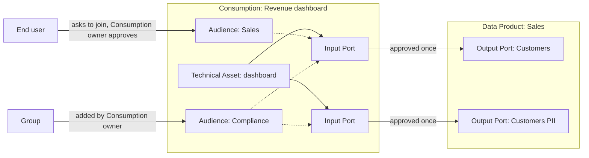

# Consumption of Data by Dashboards, Applications and End Users

**Status:** Proposed. Up for a team vote between Option 1 and Option 2.

## Context and Problem Statement

Portal models two things that hold an Input Port on an Output Port: a Data Product and an Exploration ([ADR-0016](./0016-light-weight-data-products.md)).
Both are kinds of the same base model, and the Input Port references that base model ([ADR-0021](./0021-input-ports-and-input-port-requests.md)).
A person never holds an Input Port; a person only requests one on behalf of a Data Product or an Exploration.

Many consumers produce nothing: a Power BI dashboard for a team, an organisation-wide report, an application or an AI agent, an integration that moves data to another system.
Today such a consumer must be modelled as a Data Product, which brings Output Ports, data contracts and a team it does not need, or as an Exploration, which has a single user as owner, cannot be shared and is short-lived.
The people who read a dashboard (end users) have no place in Portal at all.
They cannot discover a dashboard, ask to see it, or be granted the data it shows.

How a dashboard reads its data decides who needs access:

* **Owner identity**: the dashboard reads with one identity, its owner's or a service principal's. Only that identity needs a grant on the Output Port.
* **Viewer identity**: the dashboard reads with the identity of each person viewing it (e.g. Power BI single sign-on to Databricks). Every end user needs a grant on the Output Port.

The question is how Portal models a consumer that only consumes, the identities that read through it and their access, without forcing it into a Data Product or an Exploration.

### Terms used in this ADR

* **Consumption**: working name for a consumer that only consumes, such as a dashboard, an application, an agent, a notebook or an integration. See the open question on its name.
* **End user**: one person who reads a Consumption without being on a team that owns data.
* **Audience**: a set of identities (users, Groups and machine users, see [ADR-0023](./0023-external-identities-group-based-auth.md)) that read through a Consumption, linked to one or more of its Input Ports. A Consumption can have several audiences, for example one that sees personal data and one that doesn't.

### The requester rule

The rule "only a Data Product or Exploration requests an Output Port, never a person" is not written down anywhere.
It protects three things, and this ADR states it in that form of three principles:

1. Purposeful: every Input Port has a holder with a stated purpose.
2. Ownership: someone who answers for it.
3. Identity: an identity the Provisioner can grant to.

"Never a person" as a direct consumer of a Data Product follows from those three principles.
Explorations already show that a person may consume when wrapped in a container with a purpose and a lifecycle.
Other tools let persons request access directly (Purview, Collibra, Unity Catalog, Witboost); Portal keeps the rule.

### Scenarios

| Scenario | Description |
|---|---|
| Team dashboard | About 5 readers who know each other. |
| Organisation-wide dashboard | About 500 readers who don't know each other and come and go. |
| Application, agent or integration | An application, an agent, or an integration that moves data to another system inside or outside the organisation, reading with a service principal. |
| Personal connection | A single person with a permanent connection. |
| Exploration | A time-boxed exploration that may grow into a dashboard later on. |
| Dashboard on own data | The team that owns a Data Product builds a dashboard on its own Output Port. |

## Decision Drivers

1. Both owner identity and viewer identity are supported.
2. The three principles of the requester rule hold.
3. End users discover a dashboard and request access without joining a team.
4. The Output Port owner sees who reads and why, with lineage to the dashboard, and can revoke access.
5. It scales to large audiences that change often.
6. It is clear for people and the Provisioner what each concept may do, at the lowest extra weight.
7. It fits Groups as owner, audience member and approver.
8. Every consumer that works with data can be listed in Portal, so the organisation sees who uses which Output Port. How much Portal governs beyond listing is the organisation's choice.
9. A team that already owns the data adds a dashboard without extra ceremony; requests and approvals appear only when an ownership boundary is crossed.
10. A team consumes other teams' data, from one or several Data Products, without having a Data Product of its own.

## Out of scope

* Mapping Power BI objects (workspace, semantic model, report, app) onto Portal concepts. This belongs to a later ADR on tools and assets.
* Deciding whether an Output Port is single-technology. That gets its own ADR; see "Relation to single-technology Output Ports".
* How an Exploration is promoted to a Consumption or a Data Product. The principles are below; the mechanics are a separate effort.
* Column masks and row filters inside the data platform. The data platform enforces them on group membership; Portal only manages who is in which audience. Splitting what each viewer sees only works with viewer identity, or with owner identity plus the BI tool's own row-level security.
* Sharing with external parties or the public: provisioning identities for external parties (such as Delta Sharing recipients or partner accounts), approving sharing outside the organisation, and public data without an identity. That needs a separate ADR. External readers of a dashboard already fit as audience members when the identity provider has them as guest users.

## Considered Options

* **Option 1: Consumption as a separate concept**: a Consumption sits next to Data Product and Exploration. It is owned by a user or Group, holds Input Ports and has audiences. It never has Output Ports.
* **Option 2: Consumer-aligned kind of Data Product**: a Data Product type maps to a fixed kind, "consumer-aligned", that may have audiences and may not have Output Ports, the way an Access Type maps to an Access Function ([ADR-0025](./0025-output-port-access-types.md)). Changing the kind to producing upgrades it in place.
* **Option 3: Output Port with audiences**: the producing Data Product adds a dashboard as an Output Port with audiences. It is always owned by the producer.
* **Option 4: Audiences on every Data Product**: no new concept or kind; any Data Product can have audiences.

Seven options from the first draft were folded into these four; Appendix C lists them and why.

## Decision Outcome

**Chosen option:** *Option 1: Consumption as a separate concept*, with *Option 2: Consumer-aligned kind of Data Product* as the alternative for the team vote.
Both handle every scenario the same way; they differ in naming, positioning and the upgrade path (see the comparison below).

A Consumption only consumes.
Publishing data that others build on makes it a Data Product: a Power BI semantic model that other teams reuse belongs in a Data Product.
A Consumption that later needs to publish means creating a Data Product; that is the main cost of Option 1.
A Consumption has a kind (dashboard, application, agent, notebook, integration); the technology lives on its Technical Assets, of types that cannot be shared.
Its owner is a user or Group, the same ownership model as a Data Product. Machine users are technically allowed as owner but discouraged.
It is built as a new kind of the base model that Data Product and Exploration share, which gives it Input Ports, time-bound access and events.

### How each scenario works

* **Team or organisation-wide dashboard.** Finance creates a Consumption "Sales attribution", states its purpose and requests the Sales Output Port. The Sales owner approves once. End users ask to join an audience, and the Consumption owner approves.
* **Dashboard on own data.** A dashboard that only the team owning the data reads, such as a quality dashboard, is a Technical Asset of a type that cannot be shared, inside its Data Product. It reads with the Data Product's identity, needs no request and no audience, and is listed as an asset of the Data Product. This works today. It becomes a Consumption once end users outside the team need to see it. This assumes the Provisioner lets a Data Product's team members read the Data Product's own data.
* **Application, agent or integration.** A Consumption whose audience holds the service principals it reads with, plus viewers when an app or agent reads on their behalf. An integration that moves data to an operational system or an external party is a Consumption; if other teams build on the target through Portal, it publishes data and is a Data Product.
* **Personal connection and exploration.** An Exploration (see "Exploration, Consumption and Data Product").
* **Only listed.** A Consumption whose audience holds only the identity it reads with. Portal has the lineage, and the organisation decides whether it governs more.

### Combining data

A Consumption holds Input Ports on any number of Output Ports from any Data Products.
It transforms only in its own tool and at query time: measures, relationships, joins across Output Ports, app logic, prompts.
The line is the kind of combining, not the number of sources:

| Combining | Example | Where it belongs |
|---|---|---|
| Light: relate a fact to a dimension, put sources side by side | Sales by region, with the region dimension from a reference Data Product | Consumption |
| Heavy: new logic and meaning, persisted and scheduled | Sales attribution from sales and HR data with commission rules | Data Product: it needs a schema and a job |

When several Consumptions repeat the same join or logic, it should move upstream into a Data Product.

### Audiences

* An audience belongs to one Consumption and is deleted with it. Reuse comes from putting the same Group from the identity provider in several audiences; Portal keeps Groups flat ([ADR-0023](./0023-external-identities-group-based-auth.md)), so an audience is not a Group of Groups.
* Members are users, Groups and machine users. Every identity that reads through a Consumption is an audience member; a Consumption has no identity of its own. This meets the third principle.
* A machine user in an audience may not write the data into storage that others read. That would be publishing without a Data Product. This is enforced by policy and visible in lineage.
* The Consumption's owners create audiences, link them to Input Ports, add members and approve requests to join.
* The Output Port owner approves the Consumption's Input Port once, following the Output Port's Access Function as today. From then on the grants of an audience's Input Ports follow its members. There is no cap on an audience and no approval per member by the Output Port owner; their control is revoking the Input Port.
* Membership of a Group follows the identity provider. A change to a Group triggers a reconcile of the Consumptions it sits in.
* Through lineage the Output Port owner sees the Consumption, its purpose, and each audience linked to their Output Port with its Groups, machine users and individual end users. Members of a Group are not expanded.
* Membership is permanent until removed.
* Every audience is linked to at least one Input Port. Removing an Input Port removes its links, and an audience left without links is removed.

Sensitive data is split with Output Ports, not inside the Consumption.
For example, the Sales Data Product publishes "Customers" and "Customers PII", and the Revenue dashboard holds an Input Port on each.
Audience "Sales" is linked to the "Customers" Input Port, and audience "Compliance" to both.
Everyone opens the same dashboard, and only Compliance sees the personal data.

### What gets provisioned

| | Data Product | Exploration | Consumption |
|---|---|---|---|
| Identity | Its own | Its owner | Its audience members |
| Grants from Input Ports | Yes | Yes, time-bound | Yes, to audience members |
| Schema for shared data, pipelines that write tables | Yes | No | No |
| Output Ports, data contracts, data quality | Yes | No | No |
| Private storage nobody else reads | Its own schema | Scratch space where the owner writes tables | Working storage only, as Technical Assets: import cache, app state, vector index, staging folder |
| Runtime or presentation | No | No | Yes, as Technical Assets: Power BI workspace and app, app hosting, serving endpoint, connection to the target system |

The Provisioner SDK gets a new resource type for a Consumption, next to Data Product, Exploration and Domain.

### Exploration, Consumption and Data Product

An Exploration is a lifecycle stage, not a type of Consumption: a personal, short-lived starting point that can grow into a Consumption or a Data Product.

| | Exploration | Consumption | Data Product |
|---|---|---|---|
| Lifespan | Short, personal, may be thrown away | Long-lived | Long-lived |
| Owner | One user | User or Group | User or Group |
| Who reads | Only the owner | Its audiences | Its team, and other Data Products through Output Ports |
| Access | Time-bound | Permanent until revoked | Permanent until revoked |
| May write tables | Yes, in its own scratch space, for itself | No, only working storage | Yes, and shares them |
| Shares | Nothing | A dashboard, app or agent with its audiences | Data, through Output Ports |

* An Exploration is promoted one way, by its owner, to a Consumption or a Data Product.
* A Consumption is never promoted to a Data Product; publishing means creating one.
* Promotion never extends access silently: the Output Port owner approves the Input Ports again for the new purpose and audience.

### Same owner

When the requester already holds approve rights on the Output Port, the request is approved automatically and recorded.
This is the permission the existing "grant directly" endpoint checks.
It applies to Data Products too: today a Data Product requesting its own team's Output Port goes to pending and the team approves itself.

### Confirmation

* A Consumption is a new kind of the shared base model, owned by a user or Group, that holds Input Ports and has audiences, and never has Output Ports.
* Persons never hold an Input Port; every identity that reads through a Consumption is an audience member.
* Audience members receive the grants of the Input Ports their audience is linked to.
* Lineage shows the Output Port owner which audience is linked to which of its Output Ports.
* Requests from someone who holds approve rights on the Output Port are approved automatically, for Consumptions and Data Products.
* A dashboard that only the owning team reads stays a not-shareable Technical Asset in its Data Product.
* Explorations stay as they are, as a lifecycle stage.

## Pros and Cons of the Options

### Comparison

🟢 good, 🟡 works with friction, 🔴 fails.

| | Option 1: Separate concept | Option 2: Consumer-aligned kind | Option 3: Output Port with audiences | Option 4: Audiences on every Data Product |
|---|---|---|---|---|
| Consume other teams' data without a Data Product, from several Data Products | 🟢 | 🟡 needs a Data Product, a lighter kind | 🔴 only the producer's own data | 🔴 needs a Data Product |
| Clear for people and the Provisioner | 🟢 | 🟢 the Provisioner reads the kind | 🟡 | 🔴 every Data Product can do everything |
| Upgrade to publishing | 🔴 create a Data Product | 🟢 change the kind in place | n/a | 🟢 nothing to change |
| Roles and Groups | 🟡 a new role scope | 🟢 reuses Data Product roles | 🟢 | 🟢 |
| Catalog growth | 🟢 a separate list | 🟡 many Data Products, needs a filter by kind | 🟢 | 🔴 producing and consuming mixed |
| "A dashboard on its own is not a Data Product" | 🟢 | 🟡 softened by "consumer-aligned" | 🟡 an Output Port nobody builds on | 🔴 |
| New concept | 🔴 yes | 🟡 types gain behaviour | 🟢 none | 🟢 none |

### Option 1: Consumption as a separate concept

* **Good, because** it is the clearest: what a Consumption can and cannot do is visible in the concept, for people and for the Provisioner.
* **Good, because** a team consumes other teams' data, from several Data Products, without a Data Product of its own.
* **Good, because** the infrastructure is light: no schema for shared data, no pipelines, no Output Ports. Its profile is close to an Exploration's.
* **Good, because** the catalog keeps Data Products for data that others build on.
* **Bad, because** it is a new concept in the domain, the UI, authorization and the provisioning events.
* **Bad, because** a Consumption that needs to publish later means creating a Data Product.
* **Bad, because** lineage stops where an integration or working storage copies the data.

### Option 2: Consumer-aligned kind of Data Product

* **Good, because** a consumer-aligned Data Product upgrades to producing in place: owner, Input Ports and audiences stay.
* **Good, because** it reuses Data Product roles, Groups, UI and events.
* **Good, because** the fixed kind keeps it as clear for the Provisioner as Option 1.
* **Neutral, because** "consumer-aligned Data Product" is an established data mesh term.
* **Bad, because** Data Product types are labels without behaviour today; giving them behaviour is new.
* **Bad, because** every dashboard becomes a Data Product, so the catalog grows and needs a filter by kind.
* **Bad, because** it softens "a dashboard on its own is not a Data Product".

### Option 3: Output Port with audiences

* **Good, because** it needs no new concept and reuses the marketplace.
* **Bad, because** only the producer can build it, so another team can't build on someone else's data, and combining several Data Products is impossible.
* **Bad, because** it dilutes an Output Port: it is no longer something other Data Products build on.

### Option 4: Audiences on every Data Product

* **Good, because** it needs no new concept and nothing changes when a Data Product starts publishing.
* **Bad, because** every Data Product can do everything, so the Provisioner handles every combination.
* **Bad, because** a producing Data Product would let end users read the data behind its Input Ports.
* **Bad, because** every dashboard needs a Data Product.

### Audiences

* **Good, because** one dashboard can show personal data to some audiences only, by reusing Output Ports and their Access Functions.
* **Good, because** one mechanism covers viewers, service principals and integrations.
* **Bad, because** after approving the Input Port, the Output Port owner fully trusts the Consumption owner with who reads the data; their control is revoking the Input Port.
* **Bad, because** new members of a Group in the identity provider get access without anyone in Portal approving them.

## Relation to single-technology Output Ports

Today an Output Port links several Technical Assets, and an Input Port request picks one access mode.
A dashboard is never an Output Port, whatever that decision: it is a Technical Asset of a type that cannot be shared.
If Output Ports become single-technology, a Power BI semantic model that other teams reuse becomes a natural Output Port of a Data Product.

| Coupling | What | Why |
|---|---|---|
| Independent | Option 1 or Option 2 | They decide what holds the Input Port, not what an Output Port contains. |
| Weakly coupled | Audience grants | An audience member needs one specific grant. With a mixed Output Port that is the access mode the Input Port chose, which the request already carries. |
| Coupled | Compatibility check | With single-technology Output Ports Portal can check that a Consumption can reach an Output Port. With mixed ones it can only warn. |

## Open Questions

1. **Name.** "Consumption" is a working name for Option 1; Option 2 would use "consumer-aligned Data Product". Candidates for Option 1:
   * Consumption: neutral, used by no tool or standard.
   * Exposure: dbt's term, but it runs opposite to Data Products exposing data through Output Ports.
   * Data Usage: used in Open Data Mesh's DPDS, Bitol's ODPS and Collibra, and carries the purpose.
   * Use Case: used in the Open Data Product Specification and Purview, and carries the purpose, but it is generic.
   * Data App: concrete for business users, but a notebook is not an app.

   Rejected: Consumer (to avoid per `CONTEXT.md`), Sink (jargon that suggests writing), Terminal, Endpoint and Destination (clash with existing meanings), Subscriber and Recipient (they name a party, not a thing).
   See Appendix A for how other tools and open standards name it.
2. **Machine users as owner.** Should Portal block machine users as owner of a Consumption or a Data Product, or only discourage it?
3. **Lifecycle.** Deletion, Finalizers and provisioning events for a Consumption, how an event identifies it and its audiences (the `requester` of [ADR-0019](./0019-event-payload-scoping.md)), and the reconcile when a Group in an audience changes.
4. **Discoverability.** The marketplace lists Output Ports for teams that build on data. End users need to find Consumptions instead:
   * Do Consumptions appear in the marketplace next to Output Ports, in a section of their own, or only through the BI tool sending end users to Portal?
   * An end user on an Output Port page cannot request it; the page points to the Consumptions built on it.
   * A Consumption has a Visibility like a Data Product ([ADR-0022](./0022-data-product-visibility.md)), so a personal dashboard stays out of search. This is the leaning.
   * The cart is for Input Port requests; joining an audience is a different flow.
5. **Organisation policy.** Whether a dashboard is only listed or also governed is decided per Consumption by its owner. Should an organisation be able to require listing or governance through Portal, for example for every dashboard that uses viewer identity?

## Appendix A: How others name it

None of the open standards has an entity for the thing that consumes; they describe the producing side.

| Source | Name | Notes |
|---|---|---|
| [dbt](https://docs.getdbt.com/docs/build/exposures) | Exposure | "A downstream use of your dbt project". Types: dashboard, notebook, analysis, ml, application. Metadata only. |
| [Collibra](https://productresources.collibra.com/docs/collibra/latest/Content/Catalog/DataSets/ta_request-access-to-data-set.htm) | Data Usage | Created by an access request; holds the assets, purpose and dates. |
| [DataHub](https://docs.datahub.com/docs/generated/metamodel/entities/dashboard) | Dashboard, Chart | One entity per kind, linked to data by "Consumes". |
| [Purview](https://learn.microsoft.com/en-us/purview/concept-data-products) | Subscribers, use cases | Subscribers of a data product; the data product lists use cases. |
| Delta Sharing | Recipient | The identity that receives a share. |
| Power BI | App, Audience | An app has audiences of readers. |
| [Bitol ODPS](https://github.com/bitol-io/open-data-product-standard/blob/main/schema/odps-json-schema-latest.json) | `usage` | Input, output and management ports; "Recommended usage of the data". |
| [Bitol ODCS](https://github.com/bitol-io/open-data-contract-standard/blob/main/docs/roles.md) | consumer | A party; `roles` lists the roles a consumer needs, with approvers. |
| [Open Data Mesh DPDS](https://github.com/opendatamesh-initiative/odm-specification-dpdescriptor/blob/main/versions/1.0.0-DRAFT.md) | `audience`, `usage` | Expectations a port declares about who uses it and how. |
| [Open Data Product Specification](https://opendataproducts.org/v4.0/) | `useCases` | Use cases of a data product; AI agents as an access type. |

## Appendix B: Ideas from other tools

Not part of this decision.
These come from the tools in Appendix A and could be added to a Consumption later:

* Purpose and attestations on a request (Purview, Collibra).
* Expiry and access reviews (Entra, Collibra).
* Manager approval as an extra tier (Purview).
* Portal as the access front door, through the request redirect of Unity Catalog and the access message of Power BI apps.
* Usage statistics on a dashboard (DataHub), and flagging Consumptions that repeat the same combination of Output Ports as a candidate for a Data Product.

## Appendix C: Options from the first draft

The first draft compared seven options and three ways to share a dashboard. They are folded into the decision above:

| First-draft option | Where it went |
|---|---|
| Dashboard in its own Data Product | Option 2 without the restriction on Output Ports; heavy for a team that produces nothing. |
| Dashboard inside an existing Data Product | Kept for dashboards that only the owning team reads. |
| Dashboard as an Exploration | Explorations are a lifecycle stage, personal and short-lived. |
| Group as requester | Groups are audience members; a Group has no purpose of its own. |
| Persons request the Output Port directly | Rejected: a person would hold the Input Port. Persons join audiences instead. |
| Recorded exposure, no access management | A Consumption whose audience holds only the identity it reads with. |
| Consumption as a new concept | Option 1. |
| Sharing through an Output Port on the Consumption | Rejected: sharing a dashboard is not publishing data. |
| Sharing through audiences | Kept: the audiences above. |
| The BI tool manages readers | Rejected: Portal's record drifts and revocation leaves Portal. |
