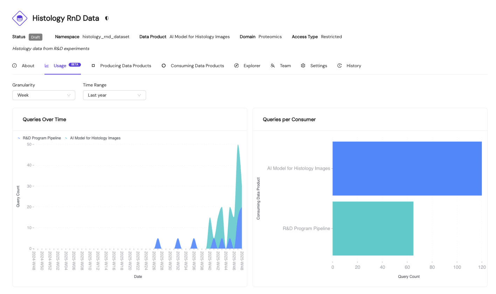

# Data Product Usage Ingestion

The Data Product Portal provides a **usage analytics** view that allows one to:
- track how datasets are being consumed over time and by which data products
- show some relevant queries for a given dataset

## Overview

To enable the usage analytics, the usage related tables have to be populated with statistics from your data platform (e.g., Snowflake, Databricks, AWS). Once ingested, this data is displayed in the portal's usage dashboards.

A simple example is shown below:



The dashboard above demonstrates how usage data is visualized, with filters for granularity (day, week, month) and time ranges (30 days, 90 days, 1 year).

## API Endpoints

Usage statistics are stored per output port. The `data_product_id` is the data product that owns the output port, `id` is the output port itself.
Pushing statistics requires the update query stats permission, which the owner roles have by default (see [RBAC](./rbac.md)).

### Query statistics

- [`PATCH /api/v2/data_products/{data_product_id}/output_ports/{id}/query_stats`](/docs/api/#tag/Data-Products-Output-ports/operation/update_output_port_query_stats) - Upsert daily query counts
- [`DELETE /api/v2/data_products/{data_product_id}/output_ports/{id}/query_stats`](/docs/api/#tag/Data-Products-Output-ports/operation/delete_output_port_query_stat) - Delete the count of one consumer for one day
- [`GET /api/v2/data_products/{data_product_id}/output_ports/{id}/query_stats`](/docs/api/#tag/Data-Products-Output-ports/operation/get_output_port_query_stats) - Read the aggregated statistics shown in the dashboard

Send one entry per day and consumer data product. The consumer is the data product whose members or technical identities ran the queries,
so you need to map the users or roles in your platform's query logs to the ID of the data product they act for.

```json
{
  "output_port_query_stats_updates": [
    {
      "date": "2025-01-15",
      "consumer_data_product_id": "6f1c2a3b-4d5e-6f70-8192-a3b4c5d6e7f8",
      "query_count": 42
    }
  ]
}
```

- `date`: the day the queries ran, as `YYYY-MM-DD`
- `consumer_data_product_id`: the ID of the consuming data product
- `query_count`: the number of queries on that day. It replaces any count sent earlier for the same day and consumer, so re-sending a day is safe

To remove an entry, send a `DELETE` request with this JSON body:

```json
{
  "date": "2025-01-15",
  "consumer_data_product_id": "6f1c2a3b-4d5e-6f70-8192-a3b4c5d6e7f8"
}

### Curated queries

- [`GET /api/v2/data_products/{data_product_id}/output_ports/{id}/curated_queries`](/docs/api/#tag/Data-Products-Output-ports/operation/get_output_port_curated_queries) - Get curated queries
- [`PUT /api/v2/data_products/{data_product_id}/output_ports/{id}/curated_queries`](/docs/api/#tag/Data-Products-Output-ports/operation/replace_output_port_curated_queries) - Replace curated queries

```json
{
  "curated_queries": [
    {
      "title": "Daily revenue",
      "description": "Revenue per day for the last month",
      "query_text": "SELECT day, SUM(amount) FROM sales GROUP BY day"
    }
  ]
}
```

## Implementation

To ingest usage data, you need to:

1. Extract usage data from your data platform's query logs or access history
2. Aggregate the data by day and map each consumer to its data product ID
3. Implement the HTTP client logic (authentication, request formatting, error handling, retries) to push the data to the API endpoint
4. Schedule the ingestion process (e.g., daily batch jobs)

### Snowflake Example

For organizations using Snowflake, we provide a sample SQL query that can be used as a starting point to extract usage statistics from Snowflake's `ACCESS_HISTORY` view. This query identifies which schemas were accessed by specific roles and aggregates query counts by consumer.

**Note**: This query requires Snowflake Enterprise Edition or higher, as it uses the `ACCESS_HISTORY` view.

We advise to use this query on a (daily) schedule.

```sql
WITH AccessLogRaw AS (
    SELECT
        ah.QUERY_ID,
        ah.USER_NAME,
        ah.QUERY_START_TIME,
        o.value:objectName::string AS full_object_name,
        SPLIT_PART(o.value:objectName::string, '.', 1) AS database_name,
        SPLIT_PART(o.value:objectName::string, '.', 2) AS schema_name
    FROM SNOWFLAKE.ACCOUNT_USAGE.ACCESS_HISTORY ah,
         LATERAL FLATTEN(input => ah.DIRECT_OBJECTS_ACCESSED) o
    WHERE ah.QUERY_START_TIME >= TO_TIMESTAMP_LTZ('{{ start_ts }}')
      AND ah.QUERY_START_TIME < TO_TIMESTAMP_LTZ('{{ end_ts }}')
)
, AccessLogFiltered AS (
    SELECT
        QUERY_ID,
        USER_NAME,
        QUERY_START_TIME,
        full_object_name,
        database_name,
        schema_name
    FROM AccessLogRaw
    WHERE UPPER(schema_name) NOT IN ('INFORMATION_SCHEMA', 'PUBLIC')
)
SELECT
    schema_name,
    user_name,
    COUNT(DISTINCT QUERY_ID) AS total_unique_queries
FROM AccessLogFiltered
GROUP BY 1, 2
ORDER BY schema_name, total_unique_queries DESC
```

### Query Parameters

Replace the following placeholders in the query:

- **`{{ start_ts }}`**: Start timestamp for the time window (e.g., `'2025-01-15 00:00:00'`)
- **`{{ end_ts }}`**: End timestamp for the time window (e.g., `'2025-01-16 00:00:00'`)
